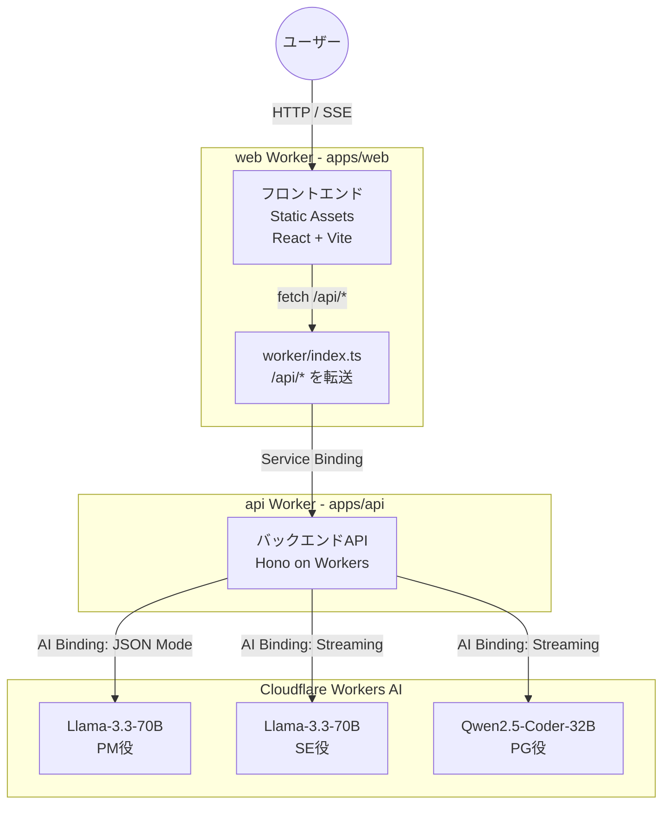
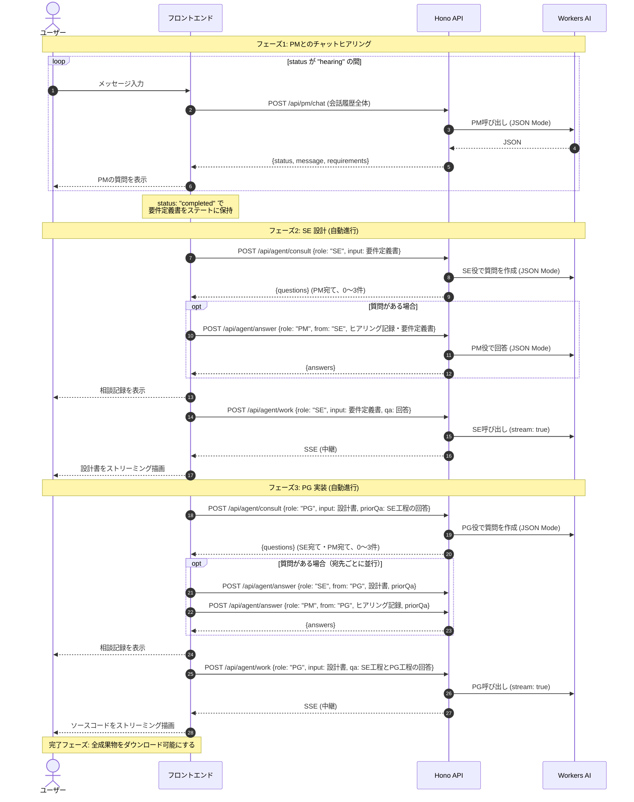

# 開発指示書: AI開発チームアプリ (Cloudflare フルスタック)

## 1. プロジェクト概要
ユーザーの作りたいアプリの要件をヒアリングし、PM・SE・PGの3つのAIエージェントが連携して「要件定義書」「設計書」「ソースコード」を自動生成するWebアプリケーションを開発する。
インフラからAI推論までをCloudflareのエコシステムで完結させるフルスタック構成とする。

- npm workspaces のモノレポとし、**2つの Cloudflare Worker** で構成する。
  - `apps/web`: React SPA を Workers Static Assets で配信し、`/api/*` を Service Binding 経由で api Worker に転送する。
  - `apps/api`: Hono のバックエンドAPI。Workers AI を呼び出す。
- 会話履歴・成果物はフロントエンドのステートのみで保持する（DB等への永続化は行わない）。
- **Cloudflare の無料枠（Workers Free プラン）の範囲内で開発・運用する**（詳細は 3.1）。

### 1.1. 作成対象の範囲（2026-11-16 ユーザー決定）
生成するアプリは、PG の出力上限（`max_tokens`）で完成できる**小規模なものに限定**する。

**作成できるもの**
1. ブラウザだけで動く小さな Web アプリ（データは localStorage に保存）
2. 単機能のスクリプトや CLI ツール
3. 数画面程度のフロントエンド、または小さな API

**作成できないもの（対象外）**: ログイン・ユーザー管理などの認証、外部データベースやクラウドサービスとの連携、決済・メール送信・外部 API 連携が必須のもの、リアルタイム通信、複数サービス構成の業務システム・EC サイト・SNS、ネイティブアプリなど。

**運用ルール**
- 対象外の依頼は、**PM がヒアリング段階で断る**（`status: "rejected"`。7.1）。断るときは理由と、対象内に収まる縮小案を示す。
- 断ったあともチャットは続けられ、ユーザーは規模を小さくして相談し直せる。ヒアリングの途中で対象外の機能が追加された場合も断る。
- 判断基準の目安（実装時に設定した値）: 画面は3つまで、API のエンドポイントは5つまで、ソースコード全体で数百行程度。
- 判断基準は `apps/api/src/ai.ts` の `SCOPE_RULES`（PM のプロンプト）、画面の案内文は `apps/web/src/lib/scope.ts` にある。**範囲を変えるときは両方を揃える。**

## 2. システムアーキテクチャとワークフロー (Mermaid)

### 2.1. アプリケーション構成図



### 2.2. 処理シーケンス
成果物の受け渡しはフロントエンドが仲介する（エージェント同士が直接通信するわけではない）。
図中の「Hono API」への通信は、すべて web Worker の Service Binding を経由する（図では省略）。



## 3. 技術スタック
- **プラットフォーム**: Cloudflare Workers（web / api の2 Worker、Service Binding で接続）
- **リポジトリ構成**: npm workspaces モノレポ
- **バックエンド**: Hono (Cloudflare Workers 上で稼働)
- **フロントエンド**: React, Vite, TypeScript, プレーンなCSS（CSSフレームワークは使用しない）
- **ランタイム**: Node.js v26 系（ルートの `.nvmrc` で固定。動作確認は v26.13.1。`cf` の要件は 22.18 以上）
- **CLI**: Cloudflare `cf` CLI（動作確認は 1.0.0-beta.32）。開発・ビルド・デプロイ・認証はすべて `cf` で行い、Wrangler を直接使わない。
  - 各ワークスペースの devDependencies に `cf` と `@cloudflare/vite-plugin@beta`（2.0 beta）を入れる。グローバルの `cf`（`npm i -g cf`）はログイン用。
- **主なバージョン**（2026-11-16 時点）: TypeScript 7、Vite 8、Vitest 5、Hono 4、React 19
  - `cf` はオープンベータのため、コマンドや設定形式が変わる可能性がある。不明点は `cf --help` と[公式ドキュメント](https://developers.cloudflare.com/cf/)で確認する。
- **ビルド/開発**: Vite + Cloudflare Vite plugin（`cf dev` / `cf build` が内部で Vite に処理を委譲する）
- **AIエンジン**: Cloudflare Workers AI（バインディング名: `AI`）
  - PM・SE用モデル: `@cf/meta/llama-3.3-70b-instruct-fp8-fast`
  - PG用モデル: `@cf/qwen/qwen2.5-coder-32b-instruct`

### 3.1. 無料枠での運用（必須要件）
Workers Free プランのみで動作させ、有料プランが必要な機能・モデルは使用しない。

**主な制限**（2026年11月時点の公式ドキュメントより。実装時に最新値を確認すること）

| 項目 | 無料枠の上限 | 超過時 |
|---|---|---|
| Workers リクエスト数 | 100,000 件/日（UTC 0時リセット） | Error 1027 |
| CPU 時間 | 10ms/リクエスト | Error 1102 |
| Workers AI | 10,000 Neurons/日 | AI 呼び出しが失敗する |
| サブリクエスト | 50 件/呼び出し | — |
| 静的アセットへのリクエスト | 無料・無制限 | — |
| Workers KV | 読み取り 100,000 件/日、書き込み 1,000 件/日 | 操作が失敗する |

**実装上のルール**
- web → api の Service Binding 呼び出しもリクエスト数に含まれるため、`/api/*` は1回の操作で2リクエストとして数える。
- CPU 時間を節約するため、SSE は `apps/api` でチャンクごとにパース・加工せず、ストリームをそのまま中継する（AI の応答待ちは CPU 時間に含まれない）。
- Workers AI の Neurons が最大のボトルネックになる。`max_tokens` は Neurons 消費を考慮して最小限に設定し、PM の再試行（7.1）も消費に含まれることに注意する。
- Neurons 消費の実測（2026-11-16、家計簿アプリを題材に PM 2回 → SE → PG を1回実行）:

| 呼び出し | 入力トークン | 出力トークン | Neurons |
|---|---|---|---|
| PM（完了時） | 284 | 190 | 46.5 |
| SE | 258 | 776 | 165.8 |
| PG | 902 | 1,619 | 201.3 |
| **1回の実行の合計**（PM 2回を含む） | | | **約 460** |

  - 実測では **1日に約20回** 完走できる。ただしヒアリングが長い場合や、SE / PG が `max_tokens` いっぱいまで出力する場合は、1回あたり最大約 2,400 Neurons（1日に約4回）まで増える。
  - 料金表（入力 / 出力 Neurons per 100万トークン）: Llama 3.3 70B は 26,668 / 204,805、Qwen2.5-Coder 32B は 60,000 / 90,909。出力トークンの単価が高い。
  - 対象範囲のルール（1.1）を PM のプロンプトに加えたため、PM の1回の呼び出しは約 35 Neurons（入力が約600トークン増加）。1回の実行全体への影響は小さい。
  - Workers AI の応答の `usage` に `neurons` が含まれる。PM は api のログに `PM usage`、相談（質問作成・回答）は `CONSULT usage` として出力し、SE / PG は SSE の最後のイベントで確認できる。
- 相談（6.5）を入れた後の実測（2026-11-16、同じ家計簿アプリ。SE・PG とも3問ずつ質問）:

| 呼び出し | 回数 | Neurons |
|---|---|---|
| PM（ヒアリング） | 2 | 約 70 |
| SE の質問作成 → PM の回答 | 2 | 約 85 |
| SE の設計 | 1 | 約 166 |
| PG の質問作成 → SE・PM の回答 | 3 | 約 165 |
| PG の実装 | 1 | 約 388 |
| **1回の実行の合計** | **9** | **約 870** |

  - 相談を入れる前（約 460）の約2倍。AI 呼び出しは1回あたり平均約 97 Neurons。
  - 相談の回答が加わったことで PG の出力が長くなった（約 6,000 → 12,600 文字。生成に約1分40秒）。
- 無料枠の超過（Workers AI のエラー等）を検知した場合は、フロントエンドに「本日の無料枠の上限に達しました」と分かるメッセージを表示する。
- 使用するモデルが無料プランで利用できることを確認する（有料プラン専用モデルは HTTP 403 / エラーコード 5035 が返る）。利用できない場合は、代替モデルをユーザーに確認してから変更する。
  - 2026-11-16 に、Llama 3.3 70B（PM / SE）と Qwen2.5-Coder 32B（PG）が無料プランで使えることを確認済み。

## 4. ディレクトリ構成
```text
workers_ai_dev_team/            # npm workspaces monorepo
├── package.json                # workspaces, "type": "module", ルートのスクリプト
├── .npmrc                      # install-strategy=nested（理由は下記）
├── .nvmrc                      # Node.js 26
└── apps/
    ├── api/                    # Backend: Hono on Workers（Worker 名: workers-ai-dev-team-api）
    │   ├── cloudflare.config.ts# Worker 定義・AI / KV バインディング・利用上限
    │   ├── vite.config.ts      # Cloudflare Vite plugin、ポート 5174、デバッグ用ポート 9230
    │   ├── vitest.config.ts    # テスト用（Cloudflare プラグインを読み込まない）
    │   ├── package.json        # exports: "./types"（web と型を共有）
    │   ├── src/
    │   │   ├── index.ts        # Hono アプリ・ルーティング
    │   │   ├── pm.ts           # POST /api/pm/chat
    │   │   ├── agent.ts        # POST /api/agent/work (SSE中継)
    │   │   ├── consult.ts      # POST /api/agent/consult・/api/agent/answer（相談）
    │   │   ├── ai.ts           # モデル定義・max_tokens・プロンプト・Workers AI 呼び出し・JSON の再試行・AI エラー分類
    │   │   ├── validate.ts     # リクエスト検証・AI 出力（PM / 質問 / 回答）の JSON 検証
    │   │   ├── usage.ts        # 1日の利用回数上限（KV）
    │   │   ├── errors.ts       # エラーレスポンス
    │   │   └── types.ts        # API のリクエスト/レスポンス型 (web と共有)
    │   └── test/               # Vitest
    └── web/                    # Frontend: React + Vite on Workers Static Assets（Worker 名: workers-ai-dev-team-web）
        ├── cloudflare.config.ts# Static Assets + api Worker への Service Binding
        ├── vite.config.ts      # React + Cloudflare Vite plugin、ポート 5173、デバッグ用ポート 9229
        ├── vitest.config.ts
        ├── tsconfig.json       # React（DOM）用
        ├── tsconfig.worker.json# Worker・設定ファイル用（Workers の型）
        ├── index.html
        ├── worker/index.ts     # /api/* を api Worker に転送
        ├── src/                # React SPA
        │   ├── main.tsx
        │   ├── App.tsx         # 状態管理・PM → SE → PG のリレー
        │   ├── components/     # StatusBoard / ChatPanel / ArtifactTabs
        │   ├── lib/            # api.ts（API 呼び出し）/ sse.ts（SSE パーサー）/ pipeline.ts（相談の流れ）/ consultation.ts（相談記録）
        │   │                   # workflow.ts（表示状態）/ scope.ts（作成対象の案内文）/ download.ts
        │   └── styles/app.css  # プレーンなCSS（ライト/ダーク対応）
        └── test/               # Vitest
```

設定ファイルは `wrangler.jsonc` ではなく、`cf` の **`cloudflare.config.ts`**（`cf/config` の `defineConfig` / `defineWorker` / `bindings` を使用）で記述する。各 Worker が自分の `cloudflare.config.ts` を持つ。

**apps/api/cloudflare.config.ts**
- `name`、`compatibilityDate`、`entrypoint`: `src/index.ts`
- `workersDev: false`（Wrangler の `workers_dev: false` と同じ）
  - Service Binding は公開 URL を閉じる仕組みではないため、既定（`true`）のままだと api が `workers.dev` で公開され、web を通らずに AI を呼ばれてしまう。api は web からの Service Binding 専用とする。
  - デプロイ後、api の `workers.dev` の URL に外部からアクセスできないことを確認する。
- `env.AI`: `bindings.ai({ dev: { remote: true } })`（Workers AI はローカルで再現できないため、開発中もリモート実行）
- `env.USAGE`: `bindings.kv()`（ID 省略。`cf deploy` が未作成の KV を自動作成する。ローカル開発ではローカルの KV を使う）
- `env.DAILY_AI_CALL_LIMIT`: `bindings.text("43")`（7.4）

**apps/web/cloudflare.config.ts**
- `name`、`compatibilityDate`、`entrypoint`: `worker/index.ts`
- `assets.notFoundHandling`: `"single-page-application"`
- `assets.runWorkerFirst`: `["/api/*"]`（`/api/*` を静的ファイルより先に Worker で処理する）
- `env.API`: `bindings.worker({ worker: "workers-ai-dev-team-api" })`
  - api の設定ファイルを import する方式は使わない。import すると api のソースが web の型環境（`Env` に `AI` / `USAGE` がない）で型チェックされてエラーになるため、Worker 名で指定する。
- 静的アセットの出力元は Vite のビルド出力で決まる（`cloudflare.config.ts` にディレクトリ指定はない）。

**npm の設定（`.npmrc`）**
- `install-strategy=nested` とし、依存パッケージを各ワークスペースの `node_modules` に入れる。
- 理由: 通常の npm workspaces はパッケージをルートにまとめて入れるが、`cf build` / `cf dev` は各ワークスペースの `node_modules` にある `@cloudflare/vite-plugin` しか見つけられず、「is declared in ... but is not installed」エラーになるため（cf 1.0.0-beta.32 で確認）。

## 5. コマンド
ルートの `package.json` に以下のスクリプトを用意し、各ワークスペースのスクリプト（中身は `cf` コマンド）を呼び出す（`-w apps/api` 等で個別実行も可）。

| 用途 | コマンド | 各ワークスペースでの実体 |
|---|---|---|
| 初回ログイン | `cf auth login` | — |
| ログイン確認 | `cf auth whoami` | — |
| ローカル開発（web + api 同時起動） | `npm run dev` | `cf dev` |
| ビルド | `npm run build` | `cf build` |
| デプロイ前の検証 | `npm run deploy:check` | `cf deploy --dry-run` |
| デプロイ | `npm run deploy`（**api → web の順**） | `cf deploy` |
| 型チェック | `npm run typecheck`（全ワークスペース） | `cf workers types && tsc` |
| テスト | `npm test`（全ワークスペース） | `vitest run` |

- `cf dev` の待ち受けポートは `cf` のオプションでは変更できないため、`vite.config.ts` の `server.port` で設定している（web: 5173 / api: 5174）。
- デバッグ用ポート（inspector）も `vite.config.ts` の `cloudflare({ inspectorPort })` で分けている（web: 9229 / api: 9230）。既定ではどちらも 9229 を使うため、同時に起動すると後から起動したほうが `EADDRINUSE` で落ちる（2026-11-16 に発生）。
- `cf workers types` は `cloudflare.config.ts` から `Env` などの型を `.cloudflare/types/` に生成する。設定を変えたら型チェック前に実行する（`npm run typecheck` に含まれる）。
- `cf build` / `cf dev` / `cf deploy` は各ワークスペースにインストールされた `cf` を使う（`npm run` 経由で実行する）。
- ログ監視（`wrangler tail` 相当）など、`cf` に未実装の機能が必要になった場合は、Wrangler を使う前にユーザーに確認する。
- web は Service Binding で api を参照するため、ローカル開発では **api と web の2つの Worker をそれぞれ別プロセスで同時に起動する**。
  - api: `npm run dev -w apps/api`（`cf dev`）
  - web: `npm run dev -w apps/web`（`cf dev`）
  - ルートの `npm run dev` で両方を並行起動する（`concurrently` を使用）。
  - 別プロセス同士の Service Binding はローカルでも自動で解決される（`bindings.worker()` の `dev` オプションは不要。2026-11-16 に動作確認済み）。
  - api は AI をリモート実行するため、**`cf auth login` でログインしていないと起動できない**。
- AIバインディングはローカル開発中も **Cloudflare上でリモート実行され、無料枠の Neurons（10,000/日）を消費する**。本番と枠を共有するため、不要な連続呼び出しを避けること。

## 6. 機能要件

### 6.1. アクターステータスボード (UI上部)
- PM(要件定義)、SE(設計)、PG(実装)の3つのアクターの現在の状態を視覚的に表示する。
- 稼働中のアクターはハイライト（CSSのbox-shadowや点滅アニメーション）し、「いま何をしているか」の詳細テキストを表示する。

### 6.2. PMとの対話フェーズ (チャットUI)
- ユーザーとPMがチャット形式で対話する。
- AIの返答は必ずJSON形式で受け取り、`status: "hearing"` の場合はチャットを継続し、`status: "completed"` になったら自動的に次のフェーズ（SE）へ移行する。
- `status: "rejected"`（対象外。1.1）の場合は SE に進まない。PM の返答（理由と縮小案）をチャットに表示し、ステータスボードの PM を「対象外」、画面上部に案内を表示する。チャットは続けられる。
- チャットが空のときは、作成できるものの一覧と対象外の例を表示する。
- 完了時にPMが生成した「要件定義書 (Markdown)」をフロントエンドのステートに保持する。

### 6.3. SE / PGフェーズ (ストリーミングUI)
- SEフェーズでは、要件定義書を入力として「基本・詳細設計書」を生成する。
- PGフェーズでは、詳細設計書を入力として「ソースコード」を生成する。
- Server-Sent Events (SSE) でWorkers AIの出力をストリーミングし、「成果物プレビューエリア」にリアルタイムで文字が打ち込まれる表示を実装する。
- APIはPOSTのため、フロントエンドは `EventSource` ではなく **`fetch` + `ReadableStream`** でSSEを読み取りパースする。

- SE / PG は作業の前に相談する（6.5）。相談中はステータスボードで質問中・回答中のアクターを示し、「相談記録」タブを表示する。

### 6.4. 成果物の表示とダウンロード
- 生成された要件定義書、相談記録、設計書、ソースコードをタブ切り替えで閲覧可能にする。
- `Blob` を用いて、各成果物をMarkdownファイル（`.md`）としてローカルにダウンロードできるボタンを実装する。

### 6.5. エージェント間の相談（2026-11-16 ユーザー決定）
SE と PG は、作業を始める前に前工程の担当者へ相談できる。

| 工程 | 質問する人 | 回答する人 | 回答に使う資料 |
|---|---|---|---|
| 設計の前 | SE | PM | ヒアリング記録・要件定義書 |
| 実装の前 | PG | SE（設計に関すること） | 要件定義書・設計書・SE 工程の相談結果 |
| 実装の前 | PG | PM（要件・仕様に関すること） | ヒアリング記録・要件定義書・SE 工程の相談結果 |

**ルール**
- 相談は**各工程1往復まで**（質問 → 回答）。質問は1工程あたり最大3件。資料だけで判断できない、成果物に大きく影響する点だけを質問する。不要なら質問しない。
- 回答者は、資料に答えがない場合は妥当な方針を決め、回答の先頭に「（仮定）」と付ける。対象外の機能（1.1）を追加する回答はしない。
- 回答は作業の入力の末尾に「着手前の確認事項と回答」として付ける。PG には SE 工程と PG 工程の両方の回答を渡す。
- PG の質問作成と、PG の質問への回答には、SE 工程の相談結果（`priorQa`）を渡す。同じ質問の繰り返しや、前の決定と矛盾する回答を防ぐため（実機で、SE が PM の決定と矛盾する回答をしたため追加）。
- 相談の質問・回答はすべて「相談記録」タブに表示し、`consultation.md` としてダウンロードできる。
- 相談には JSON Mode が必要なため、すべて Llama 3.3 70B で行う。Qwen2.5-Coder は JSON Mode に対応していないため、PG の質問作成も Llama に PG 役をさせる。
- 失敗時の扱い:
  - AI の出力が解釈できない（再試行後も `AI_INVALID_OUTPUT`）場合は、相談を省略または「回答なし」として作業を続ける（相談記録に理由を表示）。
  - 利用上限・無料枠超過などのエラーは工程を止め、その工程から再試行できるようにする。
- 相談の呼び出しも1日の利用回数（7.4）に数える。

## 7. バックエンド実装仕様 (Hono)

### 7.1. PM用エンドポイント (`POST /api/pm/chat`)
- リクエスト: `{ messages: [{ role: "user" | "assistant", content: string }] }`
- 処理: Workers AI を JSON Mode（`response_format: { type: "json_schema", json_schema: {...} }`）で呼び出す。
- レスポンス:
  ```ts
  {
    status: "hearing" | "completed" | "rejected";
    message: string;              // ユーザーへの質問・返答（rejected のときは対象外の理由と縮小案）
    requirements: string | null;  // completed のときのみMarkdown、それ以外は null
  }
  ```
- JSONのパースまたはスキーマ検証に失敗した場合は1回だけ再試行し、それでも失敗したらエラーレスポンス（HTTP 502）を返す。
- 実機での挙動（2026-11-16 確認）:
  - JSON Mode の `response` はオブジェクトで返る（文字列で返る場合にも備えて両方に対応している）。
  - `status: "completed"` のとき `message` が空文字で返ることがある。その場合は api で既定の文言（「要件定義書を作成しました。…」）を補う。`hearing` / `rejected` で `message` が空の場合は不正として再試行する。
  - 対象範囲の判断（1.1）の確認結果: 「ログイン・決済付きの EC サイト」→ `rejected`、「ポモドーロタイマー」→ `hearing`、「上長承認付きの勤怠管理システム」→ `rejected`（縮小案として「出退勤を記録するだけのアプリ」を提示）。

### 7.2. エージェント用エンドポイント (`POST /api/agent/work`)
- リクエスト: `{ role: "SE" | "PG", input: string }`（input は前工程の成果物）
- 処理: Workers AI を `stream: true` で呼び出す。
- レスポンス: `text/event-stream`。Workers AI のストリーム（`data: {"response": "..."}` 〜 `data: [DONE]`）をそのまま中継する。
- 実機でのストリームの形式（2026-11-16 確認）。パースは web の `apps/web/src/lib/sse.ts` で行う:
  - Llama 3.3 70B: 1つのイベントに `response` と OpenAI 互換の `choices[0].delta.content` の**両方**が入る。
  - Qwen2.5-Coder 32B: `response` のみ。
  - **トークンが JSON として解釈できる文字列（`3`、`[]`、`true` など）のとき、`response` が文字列ではなく数値・配列・真偽値で届く。** そのまま文字列だけを拾うと、数字やコード中の `[]` が消える。
  - 対策: 文字列の `choices[0].delta.content` があれば優先し、なければ `response` を文字列に戻して使う。ただし `007` や `1.0` のような表記は元に戻せない（Qwen の出力で起こりうる既知の制限）。
  - 最後のイベントに `usage`（`neurons` を含む）が入る。
  - Service Binding 経由でも途中で途切れずに `[DONE]` まで届くことを確認済み（PG で約50秒・1,600イベント）。

### 7.3. 共通
- Workers AI の `max_tokens` はデフォルト値が小さいため、**必ず明示的に指定する**（PM/SE/PGごとに定数化し、各モデルのコンテキスト長の上限を確認したうえで設定する）。
- 入力が長すぎてコンテキスト長を超える場合は、エラーとしてフロントエンドに通知する。
- 不正なリクエスト（role不正、必須項目なし）は HTTP 400 を返す。
- 設定値（`apps/api/src/ai.ts` / `validate.ts`）:
  - `max_tokens`: PM 2,048 / SE 4,096 / PG 4,096 / 質問作成 512 / 回答 1,024（既定値は 256。コンテキスト長は Llama 3.3 70B が 24,000、Qwen2.5-Coder 32B が 32,768 トークン）
  - 入力の上限: 40,000 文字、PM の会話履歴は 40 件まで（超えたら `INPUT_TOO_LONG`）
- エラーレスポンスは `{ error: { code, message } }` 形式で返す。`code` の一覧:

| code | HTTP | 発生条件 |
|---|---|---|
| `INVALID_REQUEST` | 400 / 404 | 入力が不正、存在しないパス |
| `INPUT_TOO_LONG` | 400 | 入力・会話が長すぎる |
| `DAILY_LIMIT_REACHED` | 429 | アプリ側の1日の利用上限（7.4） |
| `AI_QUOTA_EXCEEDED` | 429 | Workers AI の無料枠超過（エラーコード 3036） |
| `MODEL_REQUIRES_PAID_PLAN` | 403 | 有料プラン専用モデル（エラーコード 5035） |
| `AI_INVALID_OUTPUT` | 502 | JSON Mode の出力（PM / 質問 / 回答）が再試行後も不正 |
| `AI_ERROR` | 502 / 500 | その他の AI・サーバーエラー |

- JSON Mode の呼び出し（PM / 質問作成 / 回答）は共通の `callJsonWithRetry`（`ai.ts`）で行い、出力が不正なら1回だけ再試行する。

### 7.4. 1日の利用回数上限
無料枠を使い切らないよう、api Worker で **AI 呼び出し回数を1日単位（UTC）で数え、上限に達したら AI を呼ばずにエラーを返す**。
- 数える対象: `POST /api/pm/chat`・`/api/agent/work`・`/api/agent/consult`・`/api/agent/answer` の呼び出し1回につき1回（JSON の再試行は数えない）。
- 上限値: `DAILY_AI_CALL_LIMIT`（`apps/api/cloudflare.config.ts` の `bindings.text("43")`）。
  - 方針: **無料枠（10,000 Neurons/日）の約5割**に収める（2026-11-16 ユーザー決定）。
  - 43 回の根拠: 実測（3.1）の1回の呼び出しあたり平均約 115 Neurons × 43 ≒ 4,950 Neurons。成果物が長いと1回あたりの消費が増えるため、厳密に5割に収まるわけではない。
  - 相談（6.5）の追加後は、1回の実行が約9回の呼び出し・約 870 Neurons（平均約 97 Neurons/回）になった。43回では約 4,200 Neurons（約4割）で、**1日に完走できるのは約4〜5回**（相談前は約6回）。
  - 値が不正なときは 43、999 を超える値は 999 として扱う。
- 数えるタイミング: AI を呼ぶ前に数える（AI 呼び出しが失敗しても1回として数える）。
- 保存先: Workers KV（バインディング名 `USAGE`）。キーは `usage:YYYY-MM-DD`、有効期限は2日。
- 上限超過時: HTTP 429、`{ error: { code: "DAILY_LIMIT_REACHED", message: "..." } }` を返し、フロントエンドは「本日の利用上限に達しました」と表示する。
- KV は結果整合性のため、同時アクセス時はカウントが多少ずれることを許容する（厳密な上限ではない）。
- KV の無料枠（書き込み 1,000 件/日、読み取り 100,000 件/日）を超えないよう、上限値は 1,000 未満にする。

### 7.5. 相談用エンドポイント（6.5）
**`POST /api/agent/consult`**（SE / PG が質問を作る）
- リクエスト: `{ role: "SE" | "PG", input: string, priorQa?: { question, answer }[] }`（`input` は SE なら要件定義書、PG なら設計書。`priorQa` は PG のときの SE 工程の相談結果）
- レスポンス: `{ questions: { to: "PM" | "SE", question: string }[] }`（0〜3件。SE の質問の宛先は PM に固定）

**`POST /api/agent/answer`**（PM / SE が質問に回答する）
- リクエスト: `{ role: "PM" | "SE", from: "SE" | "PG", questions: string[], requirements: string, design?: string, messages?: ChatMessage[], priorQa?: QaItem[] }`
  - SE が回答できるのは PG からの質問だけで、`design` が必須。PM の回答には `messages`（ヒアリング記録）を渡す。
- レスポンス: `{ answers: { question, answer }[] }`（質問と同じ順番）

**`POST /api/agent/work` への追加**: `qa?: { question, answer }[]`（最大6件）。入力の末尾に「着手前の確認事項と回答」として付けて AI に渡す。

**実機での挙動（2026-11-16 確認）**
- 回答の先頭に「1.」「2. (仮定)」のような番号が付くことがある。api の `normalizeAnswer` で番号を取り除き、仮定の印を「（仮定）」にそろえる。
- SE・PG は、家計簿アプリの例でそれぞれ3問ずつ質問した（例: SE→PM「カテゴリは固定リストか、自由に追加できるか」）。回答は設計書・ソースコードに反映された。

## 8. プロンプト要件

実装は `apps/api/src/ai.ts` の `SYSTEM_PROMPTS`。以下に加え、次の指示を入れている。
- 全員: 日本語で回答する。
- PM: 作成対象の範囲（`SCOPE_RULES`。1.1）と、対象外なら `status: 'rejected'` として理由と縮小案を返すこと。要件定義書に対象外の機能を含めないこと。質問は一度に3つ程度まで。
- SE: 小規模なアプリのため、ファイル数・画面数を必要最小限にする。
- PG: 必要最小限のファイル構成で、すべてのファイルを省略せずに出力する。
- 相談（6.5）のプロンプトは `CONSULT_PROMPTS`（SE / PG の質問作成）と `ANSWER_PROMPTS`（PM / SE の回答）。質問は最大3件・重要な点のみ、回答は3文以内・番号なし・資料にない点は「（仮定）」、前の相談結果と矛盾しないこと、を指示している。

- **PMのシステムプロンプト**:
  「あなたは優秀なPMです。ユーザーと対話し要件を定義します。情報が足りない場合はstatus: 'hearing'とし質問をmessageに入れ、requirementsはnullにしてください。十分に情報が集まったらstatus: 'completed'とし、requirementsにMarkdown形式の要件定義書を出力してください。」
- **SEのシステムプロンプト**:
  「あなたは経験豊富なSEです。入力された要件定義書をもとに、基本設計書および詳細設計書をMarkdown形式で作成してください。」
- **PGのシステムプロンプト**:
  「あなたは熟練のPGです。入力された詳細設計書に厳密に従い、実際に動作するクリーンなソースコードと実行手順を出力してください。」

## 9. コーディング規約
- TypeScript は `strict: true` とし、`any` は原則使用しない。
- フロントエンドとバックエンドで共有する型（APIのリクエスト/レスポンス）は `apps/api/src/types.ts` に定義し、web からは `@workers-ai-dev-team/api/types` として import する（型を重複して定義しない）。
- api の各ファイルの役割（ルーティング / エンドポイント / AI呼び出し / 検証 / 利用回数）を混在させない。
- テストしやすいよう、ロジック（検証・パース・状態算出）は純粋な関数に分け、`cloudflare:workers` などランタイム固有の import に依存させない。
- テストは `vitest.config.ts`（Cloudflare プラグインなし）で実行する。`vite.config.ts` を読み込むとリモートの Workers AI に接続しようとするため。
- スタイルはプレーンなCSSで記述する（Tailwind等のCSSフレームワークは導入しない）。

## 10. 開発の進め方

AIエディタは以下の順序で実装を進めてください。

1. **初期セットアップ**: Node.js 最新版と `cf` CLI を用意し、`cf auth login` でログインする。npm workspaces のモノレポを作成し、`apps/api`（Hono + AI バインディング `AI`）と `apps/web`（Vite + React + Cloudflare Vite plugin、Service Binding `API`）の `cloudflare.config.ts` を用意する。プロジェクトの雛形作成には `cf init` を使ってよい。
2. **バックエンド実装**: `apps/api/src/` に Hono でエンドポイントを構築し、Workers AI への接続を確認する。
3. **フロントエンド実装 (UIモック)**: `apps/web/src/` に React でチャット画面、ステータスボード、成果物タブの静的なUIを作成。
4. **統合と状態遷移ロジック**: `apps/web/worker/index.ts` で `/api/*` を api Worker に転送し、フロントエンドから PM(JSON) → SE(Stream) → PG(Stream) のリレー処理を実装（SSE が Service Binding 経由でも途切れずに流れることを確認する）。
5. **最終調整**: ストリーミングのパース処理、ダウンロード機能、エラーハンドリングの実装。

### 10.1. 進捗（2026-11-16 時点）
- [x] 1〜5 の実装（`cf auth login` を除く）
- [x] 型チェック・単体テスト（api 68件 / web 29件）・ビルドが通ることを確認
- [x] ローカルで api / web を同時起動し、web 経由の `/api/*` 転送・入力検証・SPA 配信を確認
- [x] 実際の Workers AI での動作確認（API を curl で直接呼び出して確認。7.1 / 7.2 の「実機での挙動」を参照）
  - 見つかった問題を修正: SSE で数字などが消える問題、PM 完了時の空メッセージ
- [x] 1回分の実行の Neurons 消費を実測（約 460 Neurons。3.1）
- [x] `DAILY_AI_CALL_LIMIT` を 43（無料枠の約5割）に変更
- [ ] ユーザーがローカルで画面から PM → SE → PG を通しで操作して確認（API 単体では確認済み）
- [x] api に `workersDev: false` を設定（api を外部に公開しない）
- [x] 作成対象の範囲を限定し、対象外の依頼を PM が断る機能を追加（1.1）。実際の AI で判断を確認済み
- [x] エージェント間の相談を追加（6.5 / 7.5）。実際の AI で SE・PG の相談から実装までを API 単体で確認済み
  - 見つかった問題を修正: 回答の番号、SE 工程の決定と矛盾する回答（`priorQa` を追加）、`npm run dev` でのデバッグ用ポートの衝突
- [x] ユーザーがローカルで画面から通しで操作して確認
- [x] 本番デプロイ（2026-11-16、ユーザーが手動で実行）。URL: https://workers-ai-dev-team-web.yoshihicode.workers.dev/
  - デプロイはユーザー自身が行う。AI は手順の案内と事前検証（`npm run deploy:check`）までとする。
  - 初回の api デプロイで、Worker の作成・アップロード後に `[10007] This Worker does not exist on your account.` が出て止まった。api は作成・デプロイ済みだったため、再デプロイで解消した（Worker の新規作成直後の反映待ちによるものと推測。cf 1.0.0-beta.32）。
  - KV `workers-ai-dev-team-api-usage` は `cf deploy` が自動作成した。
- [x] api の `workers.dev` の URL に外部からアクセスできないことを確認（`error code: 1042`。`subdomain.enabled: false`）

## 11. 決定事項（2026-11-16 ユーザー確認済み）
- **公開範囲**: 認証なし（URL を知っている人は誰でも利用できる）。必要になったら Cloudflare Access 等を後から追加する。
- **利用制限**: 1日の AI 呼び出し回数に上限を設ける（7.4）。上限は無料枠の約5割（43回）。
- **デプロイ**: ローカルで動作確認してから本番デプロイする。
- **作成対象**: 小規模なアプリに限定し、対象外は PM がヒアリング段階で断る（1.1）。
- **エージェント間の相談**: SE は PM に、PG は SE / PM に、作業前に相談する（6.5。AI 同士で回答し、ユーザーには確認しない）。
- **テスト**: Vitest を導入し、AI を呼ばない部分（入力検証、JSON 検証、SSE パース、利用回数カウント等）を単体テストする。テストで実際の Workers AI を呼ばない（Neurons を消費しない）。
- **Node.js**: v26 系を使い、ルートの `.nvmrc` で固定する。

※不明な点がある場合は、勝手に推測せず、ユーザーに質問を提示してから実装を進めること。
