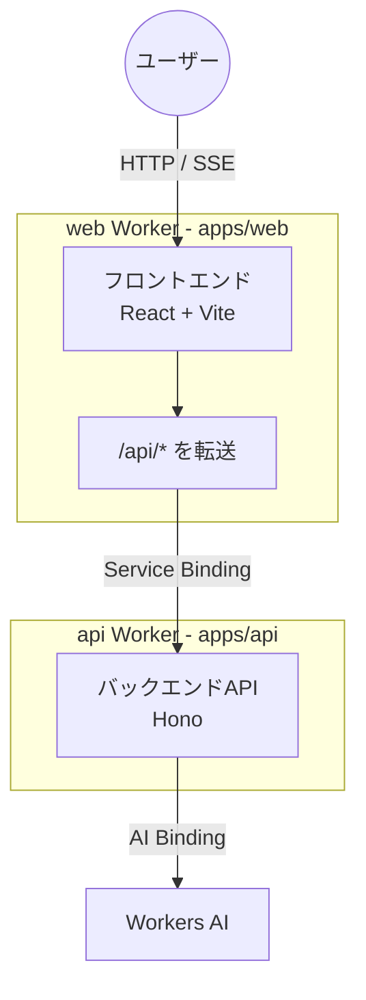

# AI開発チーム

作りたいアプリのイメージを伝えるだけで、PM・SE・PG の3つの AI エージェントが連携し、**要件定義書 → 設計書 → ソースコード** を順番に自動生成する Web アプリです。
Cloudflare Workers と Workers AI だけで動作し、**Cloudflare の無料枠の範囲内**で運用します。

> **このアプリについて**
> AI エージェントによる開発チームのサンプルです。実用に耐えるかどうかではなく、「AI エージェントで開発チームをどのように実装できるか」を試すための、個人的な実験アプリです。
> エージェントの役割分担、成果物の受け渡し、エージェント同士の相談といった仕組みを確認することを目的としています。生成される要件定義書・設計書・ソースコードの品質や、そのまま動くことは保証しません。

## 作成できるもの

PG の出力量に上限があるため、**小規模なアプリに限定**しています。

- ブラウザだけで動く小さな Web アプリ（データは localStorage に保存）
- 単機能のスクリプトや CLI ツール
- 数画面程度のフロントエンド、または小さな API

ログイン機能、外部データベース、決済、リアルタイム通信、複数サービスで構成する業務システムなど、規模の大きいアプリは作成できません。このような依頼は、PM がヒアリングの段階で「対象外」として断り、機能を絞った縮小案を提案します。

## 主な機能

- **PM とのチャットヒアリング**: PM エージェントが質問を重ね、十分な情報が集まると要件定義書を作成します。
- **自動の設計・実装**: 要件定義書が完成すると、SE が設計書を、PG がソースコードを自動で生成します。
- **エージェント間の相談**: SE は設計の前に PM へ、PG は実装の前に SE・PM へ、分からない点を質問します（各工程1往復・最大3問）。回答は AI 同士で行い、資料にない点は「（仮定）」として決めます。やり取りは「相談記録」タブで確認できます。
- **リアルタイム表示**: 生成中の設計書やコードを、ストリーミングで逐次画面に表示します。
- **ステータスボード**: 3つのエージェントのうち、どれが今どの作業をしているかを表示します。
- **ダウンロード**: 生成された各成果物を Markdown ファイルとして保存できます。

## エージェントと使用モデル

| エージェント | 役割 | モデル（Workers AI） |
|---|---|---|
| PM | ヒアリング・要件定義 | `@cf/meta/llama-3.3-70b-instruct-fp8-fast` |
| SE | 基本設計・詳細設計 | `@cf/meta/llama-3.3-70b-instruct-fp8-fast` |
| PG | ソースコード生成 | `@cf/qwen/qwen2.5-coder-32b-instruct` |

## 構成



- **apps/web**: React の画面を配信し、`/api/*` へのリクエストを api Worker に転送します。
- **apps/api**: Hono で API を提供し、Workers AI を呼び出します。

### ディレクトリ構成

```text
workers_ai_dev_team/        # npm workspaces モノレポ
└── apps/
    ├── api/                # バックエンド: Hono on Workers（ローカル: http://localhost:5174。外部には公開しない）
    │   ├── cloudflare.config.ts
    │   ├── src/
    │   └── test/
    └── web/                # フロントエンド: React + Vite on Workers Static Assets（ローカル: http://localhost:5173）
        ├── cloudflare.config.ts
        ├── vite.config.ts
        ├── worker/index.ts
        ├── src/
        └── test/
```

## 技術スタック

- Cloudflare Workers（Static Assets / Service Binding）
- Cloudflare Workers AI
- Hono
- React / Vite / TypeScript / プレーンな CSS
- Vitest（単体テスト）
- npm workspaces
- Cloudflare `cf` CLI（オープンベータ）

## セットアップ

### 必要なもの

- Node.js v26 系（`.nvmrc` で指定。`cf` CLI は 22.18 以上が必要）
- Cloudflare `cf` CLI
- Cloudflare アカウント（無料プランで可）

### 手順

```bash
# Node.js 26 を使う（nvm の場合）
nvm install
nvm use

# cf CLI のインストール（ログイン用）
npm i -g cf

# Cloudflare へのログイン（ブラウザで承認。Workers AI の呼び出しに必要）
cf auth login

# 依存パッケージのインストール
npm install

# ローカル開発（api と web の2つの Worker を同時に起動）
npm run dev
# → ブラウザで http://localhost:5173 を開く
```

> 依存パッケージは `.npmrc` の設定（`install-strategy=nested`）により、各ワークスペースの `node_modules` にインストールされます。`cf` CLI が各ワークスペースの Vite プラグインを探すためです。

## 使い方

1. 左のチャット欄に、作りたいアプリのイメージを入力して送信します（Enter で送信、Shift+Enter で改行）。
2. PM からの質問に答えます。十分な情報が集まると、PM が要件定義書を作成します。
   - 対象外の依頼と判断された場合は、PM の縮小案を参考に機能を絞って入力し直すか、「最初からやり直す」で別のアプリを相談してください。
3. 続けて SE が設計書を、PG がソースコードを自動で作成します。それぞれ作業の前に相談が行われ、その間は「相談記録」タブに質問と回答が表示されます。設計書とソースコードは、生成中の内容がリアルタイムで表示されます（ソースコードは1〜2分かかることがあります）。
4. 各タブのボタンで成果物（要件定義書・相談記録・設計書・ソースコード）を Markdown ファイル（`.md`）としてダウンロードできます。すべて完了すると「すべてダウンロード」も使えます。
5. 途中でエラーになった場合は、エラーが起きた工程（SE / PG）から再試行できます。「最初からやり直す」で最初に戻ります。

## コマンド

| 用途 | コマンド |
|---|---|
| ローカル開発 | `npm run dev`（各 Worker で `cf dev`） |
| ビルド | `npm run build`（各 Worker で `cf build`） |
| 型チェック | `npm run typecheck` |
| テスト | `npm test`（Workers AI は呼ばないため Neurons を消費しません） |
| デプロイ前の検証 | `npm run deploy:check`（`cf deploy --dry-run`） |
| デプロイ | `npm run deploy`（api → web の順に `cf deploy`） |

> `cf` CLI はオープンベータのため、コマンドが変わる可能性があります。最新情報は[公式ドキュメント](https://developers.cloudflare.com/cf/)を確認してください。

## 無料枠についての注意

このアプリは Cloudflare Workers の無料プランで動かすことを前提にしています。主な上限は次のとおりです（2026年11月時点。最新の値は[公式ドキュメント](https://developers.cloudflare.com/workers/platform/limits/)を確認してください）。

| 項目 | 上限 |
|---|---|
| Workers リクエスト数 | 100,000 件/日 |
| CPU 時間 | 10ms/リクエスト |
| Workers AI | 10,000 Neurons/日 |

- **Workers AI の Neurons が最も早く上限に達します。** 実測では、要件定義から実装までの1回の実行（相談を含む）で、AI を約9回呼び出し、約 870 Neurons を使いました。ヒアリングが長い場合や成果物が長い場合はさらに増えます。
- 無料枠を使い切らないよう、アプリ側でも **AI の呼び出しを1日43回まで**（無料枠の約5割が目安）に制限しています。**1日に完走できるのは4〜5回程度**です（`apps/api/cloudflare.config.ts` の `DAILY_AI_CALL_LIMIT` で変更できます）。
- ローカル開発中も Workers AI は Cloudflare 上で実行されるため、本番と同じ無料枠を消費します。
- 上限に達した場合は、画面にメッセージが表示されます。翌日（UTC 0時 = 日本時間 9時）以降に再度お試しください。

## 開発者向け情報

開発方針・API 仕様・コーディング規約は [CLAUDE.md](CLAUDE.md) を参照してください。
