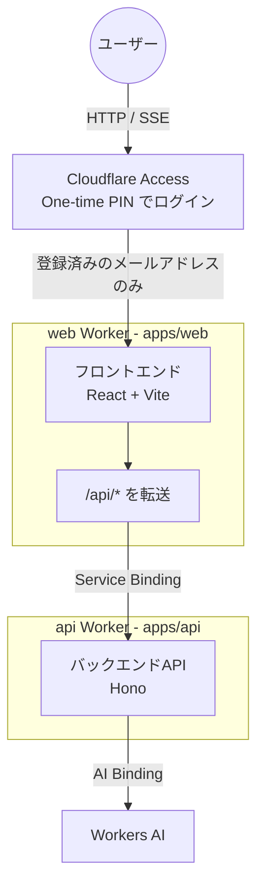

# AI開発チーム

作りたいアプリのイメージを伝えるだけで、PM・SE・PG の3つの AI エージェントが連携し、**要件定義書 → 設計書 → ソースコード** を順番に自動生成する Web アプリです。
Cloudflare Workers と Workers AI だけで動作し、**Cloudflare の無料枠の範囲内**で運用します。

**Live Demo**: https://workers-ai-dev-team-web.yoshihicode.workers.dev/

> **Live Demo の利用にはログインが必要です**
> Cloudflare Access で保護しており、登録済みのメールアドレスの人だけが利用できます。メールアドレスを入力すると届く PIN（ワンタイムパスワード）を入力してログインします。
> 利用したい方は、[GitHub Issues](https://github.com/yoshihicode/workers_ai_dev_team/issues) からログイン用のメールアドレスの追加をご依頼ください。

> **このアプリについて**
> AI エージェントによる開発チームのサンプルです。実用に耐えるかどうかではなく、「AI エージェントで開発チームをどのように実装できるか」を試すための、個人的な実験アプリです。
> エージェントの役割分担、成果物の受け渡し、エージェント同士の相談、レビューと作り直しといった仕組みを確認することを目的としています。生成される要件定義書・設計書・ソースコードの品質や、そのまま動くことは保証しません。

## 作成できるもの

PG の出力量に上限があるため、**小規模なアプリに限定**しています。

- ブラウザだけで動く小さな Web アプリ（データは localStorage に保存）
- 単機能のスクリプトや CLI ツール
- 数画面程度のフロントエンド、または小さな API

ログイン機能、外部データベース、決済、リアルタイム通信、複数サービスで構成する業務システムなど、規模の大きいアプリは作成できません。このような依頼は、PM がヒアリングの段階で「対象外」として断り、機能を絞った縮小案を提案します。

## 主な機能

- **PM とのチャットヒアリング**: PM エージェントが質問を重ね、十分な情報が集まると要件定義書を作成します。
- **自動の設計・実装**: 要件定義書が完成すると、SE が設計書を、PG がソースコードを自動で生成します。
- **エージェント間の相談**: SE は設計の前に PM へ、PG は実装の前に SE・PM へ、分からない点を質問します（各工程1往復・最大3問）。回答は AI 同士で行い、資料にない点は「（仮定）」として決めます。やり取りは「相談記録」タブで確認できます。
- **レビューと作り直し**: PG のソースコードを、SE（設計どおりか）と PM（要件を満たしているか）がレビューします。指摘があれば PG が1回だけ作り直します。指摘は「レビュー記録」タブ、修正前のコードは「修正前のコード」タブで確認できます。
- **リアルタイム表示**: 生成中の設計書やコードを、ストリーミングで逐次画面に表示します。
- **ステータスボード**: 3つのエージェントのうち、どれが今どの作業をしているかを表示します。
- **ダウンロード**: 生成された各成果物を Markdown ファイルとして保存できます。

## エージェントと使用モデル

| エージェント | 役割 | モデル（Workers AI） |
|---|---|---|
| PM | ヒアリング・要件定義 | `@cf/meta/llama-3.3-70b-instruct-fp8-fast` |
| SE | 基本設計・詳細設計 | `@cf/meta/llama-3.3-70b-instruct-fp8-fast` |
| PG | ソースコード生成 | `@cf/qwen/qwen2.5-coder-32b-instruct` |

相談（質問の作成・回答）とレビューは、JSON 形式で応答させる必要があるため、PG の質問作成も含めてすべて Llama 3.3 70B で行っています。つまり、PG のコード生成以外の工程は、すべて同じ AI が役割を演じ分けています。

## このアプリの弱点（すべての工程で同じ AI を使っていること）

PM・SE・PG は、別々の専門家ではありません。ほぼ同じ AI（主に Llama 3.3 70B）に、プロンプトで役割を指示しているだけです。そのため、人間のチームで役割を分ける効果の多くは得られません。

- **相談しても新しい情報が出てこない**: 回答する PM や SE も、質問した側と同じ AI が同じ資料を読んで答えています。資料にないことは誰も知らないため、回答の多くは「（仮定）」として AI が決めたものです。役割を分けて記録が残る効果はありますが、ユーザーに確認したときのように情報が増えるわけではありません。
- **レビューが自己レビューに近い**: 作った AI と同じ知識・同じ判断の癖でレビューするため、同じ盲点を見落としやすくなります。実際に試したところ、存在しない問題の指摘や、修正内容が決まらない指摘が出ることがありました。また、同じ入力でも結果がぶれます。
- **前工程の誤りが後工程に引き継がれる**: 要件定義書に抜けや誤りがあると、設計・実装・レビューのすべてが同じ前提で進みます。同じ AI なので、途中で誤りに気づく仕組みになっていません。
- **正しさを確かめる手段が AI の判断だけ**: 生成したコードを実行したりテストしたりはしていません。「動くかどうか」はレビュー担当の AI がコードを読んで判断しているだけです。
- **知識が古い・偏っている**: すべての工程が同じ AI の学習時点の知識に依存します。現在は推奨されていない手順（例: create-react-app）を出力することがあり、それを指摘できる工程もありません。

これらを補う方法として、工程ごとに異なるモデルを使う、生成したコードを実際に実行して検証する、判断に迷う点はユーザーに確認する、などが考えられます。ただし、どれも無料枠や仕組みの複雑さとのトレードオフがあり、現時点では実装していません。

## 構成



- **Cloudflare Access**: web Worker の手前でログインを求めます。登録済みのメールアドレスに届く PIN でログインした人だけが画面と API を使えます。設定は Cloudflare のダッシュボードで行い、コードには含めていません（ローカル開発ではログインは不要です）。
- **apps/web**: React の画面を配信し、`/api/*` へのリクエストを api Worker に転送します。
- **apps/api**: Hono で API を提供し、Workers AI を呼び出します。

### ディレクトリ構成

```text
workers_ai_dev_team/        # npm workspaces モノレポ
└── apps/
    ├── api/                # バックエンド: Hono on Workers（ローカル: http://localhost:5174。外部には公開しない）
    │   ├── cloudflare.config.ts
    │   ├── src/
    │   └── test/
    └── web/                # フロントエンド: React + Vite on Workers Static Assets（ローカル: http://localhost:5173）
        ├── cloudflare.config.ts
        ├── vite.config.ts
        ├── worker/index.ts
        ├── src/
        └── test/
```

## 技術スタック

- Cloudflare Workers（Static Assets / Service Binding）
- Cloudflare Workers AI
- Cloudflare Access（Zero Trust。One-time PIN によるログイン）
- Hono
- React / Vite / TypeScript / プレーンな CSS
- Vitest（単体テスト）
- npm workspaces
- Cloudflare `cf` CLI（オープンベータ）

## セットアップ

### 必要なもの

- Node.js v26 系（`.nvmrc` で指定。`cf` CLI は 22.18 以上が必要）
- Cloudflare `cf` CLI
- Cloudflare アカウント（無料プランで可）

### 手順

```bash
# Node.js 26 を使う（nvm の場合）
nvm install
nvm use

# cf CLI のインストール（ログイン用）
npm i -g cf

# Cloudflare へのログイン（ブラウザで承認。Workers AI の呼び出しに必要）
cf auth login

# 依存パッケージのインストール
npm install

# ローカル開発（api と web の2つの Worker を同時に起動）
npm run dev
# → ブラウザで http://localhost:5173 を開く
```

> 依存パッケージは `.npmrc` の設定（`install-strategy=nested`）により、各ワークスペースの `node_modules` にインストールされます。`cf` CLI が各ワークスペースの Vite プラグインを探すためです。

## 使い方

1. 左のチャット欄に、作りたいアプリのイメージを入力して送信します（Enter で送信、Shift+Enter で改行）。
2. PM からの質問に答えます。十分な情報が集まると、PM が要件定義書を作成します。
   - 対象外の依頼と判断された場合は、PM の縮小案を参考に機能を絞って入力し直すか、「最初からやり直す」で別のアプリを相談してください。
3. 続けて SE が設計書を、PG がソースコードを自動で作成します。それぞれ作業の前に相談が行われ、その間は「相談記録」タブに質問と回答が表示されます。設計書とソースコードは、生成中の内容がリアルタイムで表示されます（ソースコードは1〜2分かかることがあります）。
4. ソースコードができると SE と PM がレビューし、「レビュー記録」タブに結果が表示されます。指摘があれば PG が作り直します（さらに2分ほどかかります）。
5. 各タブのボタンで成果物（要件定義書・相談記録・設計書・ソースコード・レビュー記録・修正前のコード）を Markdown ファイル（`.md`）としてダウンロードできます。すべて完了すると「すべてダウンロード」も使えます。
6. 途中でエラーになった場合は、エラーが起きた工程（SE / PG / レビュー / 作り直し）から再試行できます。「最初からやり直す」で最初に戻ります。
7. Live Demo では、画面右上の「ログアウト」でログアウトできます（ローカル開発では表示されません）。

## コマンド

| 用途 | コマンド |
|---|---|
| ローカル開発 | `npm run dev`（各 Worker で `cf dev`） |
| ビルド | `npm run build`（各 Worker で `cf build`） |
| 型チェック | `npm run typecheck` |
| テスト | `npm test`（Workers AI は呼ばないため Neurons を消費しません） |
| デプロイ前の検証 | `npm run deploy:check`（`cf deploy --dry-run`） |
| デプロイ | `npm run deploy`（api → web の順に `cf deploy`） |

> `cf` CLI はオープンベータのため、コマンドが変わる可能性があります。最新情報は[公式ドキュメント](https://developers.cloudflare.com/cf/)を確認してください。

## Cloudflare Access の設定（本番環境）

デプロイした web Worker に、One-time PIN（メールで届く PIN）でのログインを設定する手順です。設定はすべて Cloudflare のダッシュボードで行います（2026年11月時点。画面の項目名はダッシュボードの英語表記です）。

1. **Zero Trust を有効にする**（初回のみ）
   ダッシュボードの **Zero Trust** を開き、案内に従って組織を作成します。無料プラン（Free）は 50 ユーザーまで利用できます。
2. **One-time PIN を追加する**（初回のみ）
   **Zero Trust** > **Integrations** > **Identity providers** > **Add new identity provider** > **One-time PIN** を選びます。
   新しい Zero Trust 組織では One-time PIN が自動では追加されないため、この手順が必要です。
3. **ログインを許可する人のポリシーを作る**
   **Zero Trust** > **Access controls** > **Policies** > **Add a policy** で、次のように設定して保存します。
   - **Action**: Allow
   - **Rules**（Include）: **Emails** を選び、許可するメールアドレスを入力
4. **web Worker を保護する**
   **Workers & Pages** > `workers-ai-dev-team-web` > **Access** タブ > **Protect this Worker behind Access** を選び、**All traffic** と手順3のポリシーを指定して適用します。
   api Worker は外部に公開していない（`workersDev: false`）ため、保護は不要です。
5. **動作を確認する**
   シークレットウィンドウで web の URL を開き、メールアドレスを入力 → 届いた PIN を入力してログインできることを確認します。許可していないメールアドレスではログインできません。

ログインできる人を追加・削除するときは、手順3のポリシーの **Emails** を編集します。

参考: [One-time PIN login](https://developers.cloudflare.com/cloudflare-one/integrations/identity-providers/one-time-pin/) / [Access policies](https://developers.cloudflare.com/cloudflare-one/access-controls/policies/policy-management/) / [Cloudflare Access（Workers）](https://developers.cloudflare.com/workers/configuration/cloudflare-access/)

## 無料枠についての注意

このアプリは Cloudflare Workers の無料プランで動かすことを前提にしています。主な上限は次のとおりです（2026年11月時点。最新の値は[公式ドキュメント](https://developers.cloudflare.com/workers/platform/limits/)を確認してください）。

| 項目 | 上限 |
|---|---|
| Workers リクエスト数 | 100,000 件/日 |
| CPU 時間 | 10ms/リクエスト |
| Workers AI | 10,000 Neurons/日 |

- **Workers AI の Neurons が最も早く上限に達します。** 実測では、要件定義から実装までの1回の実行（相談・レビュー・作り直しを含む）で、AI を約11回呼び出し、約 1,860 Neurons を使いました。ヒアリングが長い場合や成果物が長い場合はさらに増えます。
- 無料枠を使い切らないよう、アプリ側でも **1日の Neurons 消費量を 5,000（無料枠の5割）まで**に制限しています。**1日に完走できるのは2〜3回程度**です（`apps/api/cloudflare.config.ts` の `DAILY_NEURON_LIMIT` で変更できます）。
- この上限は Live Demo を使う全員で共有です。
- ローカル開発中も Workers AI は Cloudflare 上で実行されるため、本番と同じ無料枠を消費します。
- 上限に達した場合は、画面にメッセージが表示されます。翌日（UTC 0時 = 日本時間 9時）以降に再度お試しください。

## 開発者向け情報

開発方針・API 仕様・コーディング規約は [CLAUDE.md](CLAUDE.md) を参照してください。
